<div align="center">
    

# Prometheus | Prostate Care
### Prostate Cancer Support Website Aotearoa

_Knowledge, support, and connection for the Aotearoa prostate cancer community._


`~⟢~`

[](https://prostatecarenz.netlify.app/)
</div>

## Branch Notes
>
> **Name:** `dev`
> 
> **Purpose:** Primary integration branch for active development. Features, fixes, and refactors are merged here before being promoted to production.
> 
> **Workflow**: `feature/* → dev → main`
> - Keep builds passing.
> - Merge tested work only.
> - Sync regularly with `main`.
>
> **Status:** Integrating RAG chatbot (In Progress)

## UI Snapshots

<table align="center">
  <tr align="center">
    <td width="300">
      
    </td>
    <td width="300">
      
    </td>
    <td width="300">
      
    </td>
  </tr>
  <tr align="center">
    <td>
      
    </td>
    <td>
      
    </td>
    <td>
      
    </td>
  </tr>
</table>

## Launching the app locally

### Requirements:

- **Operating System:**
  - (a) Windows 10 or Windows 11 environment  
    &nbsp;&nbsp;&nbsp;&nbsp;- WSL2 installed to launch Linux Ubuntu environment  
    &nbsp;&nbsp;&nbsp;&nbsp;- Ubuntu LTS 22.04 distro installed
  - (b) Linux Ubuntu (**preferred**)

- **Software:**
  - Visual Studio Code installed
  - Node.js and Git installed
  - Docker (to install Ollama and PostgreSQL containers)

### Main Steps

1. Cloning the repository:

```bash
git clone https://github.com/arzen1kos/prostate-care.git

# To automatically initialize and fetch all submodules, use this instead
git clone --recurse-submodules https://github.com/arzen1kos/prostate-care.git 

cd prostate-care
```

2. Installing the package for dependencies

In the parent directory, run the following commands:

```bash
rm -rf node_modules
rm -rf package-lock.json
npm install
```

3. Launching the app

In the parent directory, run the following commands:

#### Module dependency resolution

```bash
npm run dev
```

## Architecture

```mermaid
%% Generated by https://gitdiagram.com/arzen1kos/prostate-care
flowchart TD

subgraph group_content["Content and guidance"]
  node_home_content["Audience guidance<br/>[home.ts]"]
  node_home_page["Home page<br/>[index.astro]"]
  node_support_pages["Support pages"]
  node_patient_page["Patient space"]
  node_clinic_page["Clinic finder<br/>[clinics.astro]"]
  node_clinic_cards["Clinic cards<br/>[ClinicCard.astro]"]
end

subgraph group_journey["Patient journeys"]
  node_decision_data["Decision tree data<br/>[decision_tree.json]"]
  node_journey_canvas["Journey canvas<br/>[Canvas.tsx]"]
  node_journey_nav["Canvas navigation<br/>[CanvasNav.astro]"]
  node_article_index["Article index<br/>[article-pages.ts]"]
  node_article_page["Article detail<br/>[&#91;slug&#93;.astro]"]
end

subgraph group_research["Research discovery"]
  node_research_page["Research hub<br/>[research-hub.astro]"]
  node_research_library["Research library"]
  node_research_search["Research search<br/>[SearchBar.tsx]"]
  node_research_topics["Research topics<br/>[research-tags.json]"]
end

subgraph group_experience["Site experience"]
  node_chat_widget["Chat widget<br/>[ChatBox.tsx]"]
  node_chat_settings["Chat settings<br/>[chatbox.json]"]
  node_site_layout["Shared layout<br/>[Layout.astro]"]
  node_header["Site navigation<br/>[Header.astro]"]
  node_footer["Site footer<br/>[Footer.astro]"]
  node_nav_content["Navigation content<br/>[navigation.ts]"]
  node_footer_content["Footer content<br/>[footer.ts]"]
end

node_visitor(("Site visitor"))
node_rag_service{{"RAG assistant service"}}

node_visitor -->|"opens"| node_home_page
node_home_page -->|"presents guidance"| node_home_content
node_visitor -->|"seeks support"| node_support_pages
node_visitor -->|"seeks resources"| node_patient_page
node_visitor -->|"finds clinics"| node_clinic_page
node_clinic_page -.->|"lists clinics"| node_clinic_cards
node_visitor -->|"explores journey"| node_journey_canvas
node_journey_canvas -->|"reads tree"| node_decision_data
node_visitor -.->|"navigates tree"| node_journey_nav
node_decision_data -->|"supplies article ids"| node_article_index
node_visitor -.->|"opens article"| node_article_page
node_visitor -->|"explores research"| node_research_page
node_research_page -.->|"shows records"| node_research_library
node_research_library -.->|"offers search"| node_research_search
node_research_library -.->|"filters topics"| node_research_topics
node_visitor -->|"asks questions"| node_chat_widget
node_chat_widget -.->|"configured by"| node_chat_settings
node_chat_widget -.->|"queries assistant"| node_rag_service
node_home_page -.->|"uses shared layout"| node_site_layout
node_site_layout -.->|"renders header"| node_header
node_site_layout -.->|"renders footer"| node_footer
node_header -->|"reads navigation"| node_nav_content
node_footer -->|"reads links"| node_footer_content

click node_home_content "https://github.com/arzen1kos/prostate-care/blob/dev/content/home.ts"
click node_home_page "https://github.com/arzen1kos/prostate-care/blob/dev/src/pages/index.astro"
click node_support_pages "https://github.com/arzen1kos/prostate-care/blob/dev/src/pages/family-support.astro"
click node_patient_page "https://github.com/arzen1kos/prostate-care/blob/dev/src/pages/patient-space.astro"
click node_clinic_page "https://github.com/arzen1kos/prostate-care/blob/dev/src/pages/clinics.astro"
click node_clinic_cards "https://github.com/arzen1kos/prostate-care/blob/dev/src/components/features/clinic/ClinicCard.astro"
click node_decision_data "https://github.com/arzen1kos/prostate-care/blob/dev/content/pages/decision_tree.json"
click node_journey_canvas "https://github.com/arzen1kos/prostate-care/blob/dev/src/components/Canvas.tsx"
click node_journey_nav "https://github.com/arzen1kos/prostate-care/blob/dev/src/components/CanvasNav.astro"
click node_article_index "https://github.com/arzen1kos/prostate-care/blob/dev/src/lib/article-pages.ts"
click node_article_page "https://github.com/arzen1kos/prostate-care/blob/dev/src/pages/articles/%5Bslug%5D.astro"
click node_research_page "https://github.com/arzen1kos/prostate-care/blob/dev/src/pages/research-hub.astro"
click node_research_library "https://github.com/arzen1kos/prostate-care/blob/dev/src/components/research/ResearchLibrary.tsx"
click node_research_search "https://github.com/arzen1kos/prostate-care/blob/dev/src/components/research/SearchBar.tsx"
click node_research_topics "https://github.com/arzen1kos/prostate-care/blob/dev/content/taxonomy/research-tags.json"
click node_chat_widget "https://github.com/arzen1kos/prostate-care/blob/dev/src/components/chatbot/ChatBox.tsx"
click node_chat_settings "https://github.com/arzen1kos/prostate-care/blob/dev/content/settings/chatbox.json"
click node_site_layout "https://github.com/arzen1kos/prostate-care/blob/dev/src/layouts/Layout.astro"
click node_header "https://github.com/arzen1kos/prostate-care/blob/dev/src/layouts/Header.astro"
click node_footer "https://github.com/arzen1kos/prostate-care/blob/dev/src/layouts/Footer.astro"
click node_nav_content "https://github.com/arzen1kos/prostate-care/blob/dev/content/common/navigation.ts"
click node_footer_content "https://github.com/arzen1kos/prostate-care/blob/dev/content/common/footer.ts"

classDef toneNeutral fill:#f8fafc,stroke:#334155,stroke-width:1.5px,color:#0f172a
classDef toneBlue fill:#dbeafe,stroke:#2563eb,stroke-width:1.5px,color:#172554
classDef toneAmber fill:#fef3c7,stroke:#d97706,stroke-width:1.5px,color:#78350f
classDef toneMint fill:#dcfce7,stroke:#16a34a,stroke-width:1.5px,color:#14532d
classDef toneRose fill:#ffe4e6,stroke:#e11d48,stroke-width:1.5px,color:#881337
classDef toneIndigo fill:#e0e7ff,stroke:#4f46e5,stroke-width:1.5px,color:#312e81
classDef toneTeal fill:#ccfbf1,stroke:#0f766e,stroke-width:1.5px,color:#134e4a
class node_home_content,node_home_page,node_support_pages,node_patient_page,node_clinic_page,node_clinic_cards toneBlue
class node_decision_data,node_journey_canvas,node_journey_nav,node_article_index,node_article_page toneAmber
class node_research_page,node_research_library,node_research_search,node_research_topics toneMint
class node_chat_widget,node_chat_settings,node_site_layout,node_header,node_footer,node_nav_content,node_footer_content toneRose
class node_visitor,node_rag_service toneIndigo
```


----

Created by Arsenie — 2025
